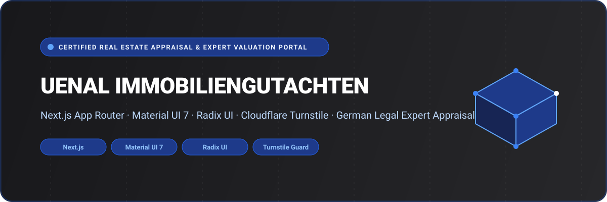

<div align="center">



# Uenal Immobiliengutachten — Certified Real Estate Appraisal & Expert Valuation Portal

A digital platform built for certified property appraisers (*Sachverständige für Immobilienbewertung*) at **Uenal Gutachten** (`uenal-gutachten.de`). Developed with **Next.js (App Router)**, **Material UI 7**, **Radix UI**, **Cloudflare Turnstile**, and **Tailwind CSS**.

[](https://nextjs.org/)
[](https://mui.com/)
[](https://www.radix-ui.com/)
[](https://developers.cloudflare.com/turnstile/)
[](https://www.typescriptlang.org/)
[](LICENSE)

</div>

---

## 🌟 Overview

**Uenal Immobiliengutachten (alpha_3rd)** serves property buyers, investors, mortgage lenders, tax advisors, and inheritance courts needing legally compliant real estate evaluations throughout Germany. The platform provides guided consultation booking and automated quote requests across standard German valuation methodologies:

- **Verkehrswertgutachten (§ 194 BauGB)**: Legally certified market value reports recognized by courts and tax offices (*Finanzamt*).
- **Kurzgutachten**: Streamlined, cost-effective valuation summaries ideal for private property purchases and asset sales.
- **Beleihungswertgutachten**: Specialized appraisals tailored for banking and mortgage financing approval.
- **Erbschafts- & Scheidungsgutachten**: Independent expert appraisals resolving estate distributions, gifting taxes, or divorce settlements.

Connected to [`alpha_backend`](https://github.com/shahjalal-labs/alpha_backend) for cryptographic Turnstile bot defense and automated report dispatch.

---

## 🚀 Key Features & Capabilities

- 📊 **Appraisal Order Wizard**: Multi-step valuation request questionnaire collecting property classification, gross floor area, year of construction, and purpose.
- 🛡️ **Cloudflare Turnstile Protection**: Server-validated bot protection without intrusive CAPTCHAs.
- 🏛️ **German Statutory Compliance**: Transparent appraisal workflows adhering strictly to ImmoWertV (Immobilienwertermittlungsverordnung).
- 📱 **Modern Material & Radix UX**: Styled with Material UI 7 components and accessible Radix UI primitives.
- ⚡ **Turbopack Build Pipeline**: Fast page loads and pre-rendered SEO landing pages for key metropolitan real estate markets.

---

## 📁 Repository Structure

```
alpha_3rd/
├── assets/
│   └── banner.svg                  # Architectural SVG project banner
├── src/
│   ├── app/                        # Next.js App Router structure
│   ├── components/                 # Appraisal wizard, service sheets, legal modals
│   └── lib/                        # Valuation parameter calculators and formatting
├── .env.example                    # Environment variable configuration template
├── package.json                    # Dependencies (Next.js, Material UI, Turnstile)
└── tsconfig.json                   # Strict TypeScript compiler options
```

---

## 💻 Tech Stack Specification

| Domain | Selected Technologies |
| :--- | :--- |
| **Framework** | Next.js (App Router) |
| **Language** | TypeScript 5 (Strict Mode) |
| **UI Design System** | Material UI (MUI) 7.3, Radix UI Primitives |
| **Styling** | Tailwind CSS, Emotion React & Styled |
| **Security** | Cloudflare Turnstile Verification |

---

## 🛠️ Getting Started & Local Development

### Prerequisites

- **Node.js**: `v20.x` or higher
- **Package Manager**: `npm`, `yarn`, or `pnpm`

### 1. Clone the Repository

```bash
git clone https://github.com/shahjalal-labs/alpha_3rd.git
cd alpha_3rd
```

### 2. Install Dependencies

```bash
npm install
```

### 3. Configure Environment Variables

Create a `.env.local` file:

```env
NEXT_PUBLIC_TURNSTILE_SITE_KEY=your_turnstile_site_key
NEXT_PUBLIC_BASE_URL=http://localhost:5000
```

### 4. Run Development Server

```bash
npm run dev
```

Open [http://localhost:3000](http://localhost:3000) to view the portal.

---

## 👨‍💻 Engineering & Authorship

Developed and engineered by **Md. Shahjalal**.

- **GitHub**: [@shahjalal-labs](https://github.com/shahjalal-labs)
- **Email**: [muhommodshahjalal@gmail.com](mailto:muhommodshahjalal@gmail.com)

---

## 📄 License

This project is open-source and available under the [ISC License](LICENSE).
